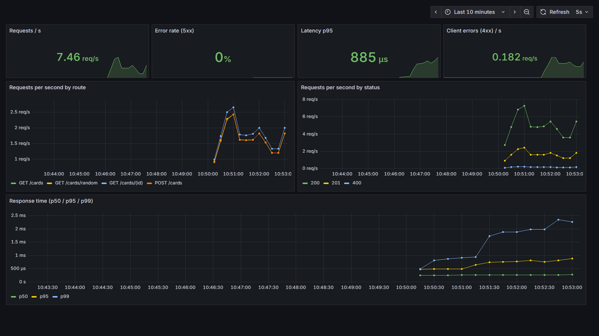
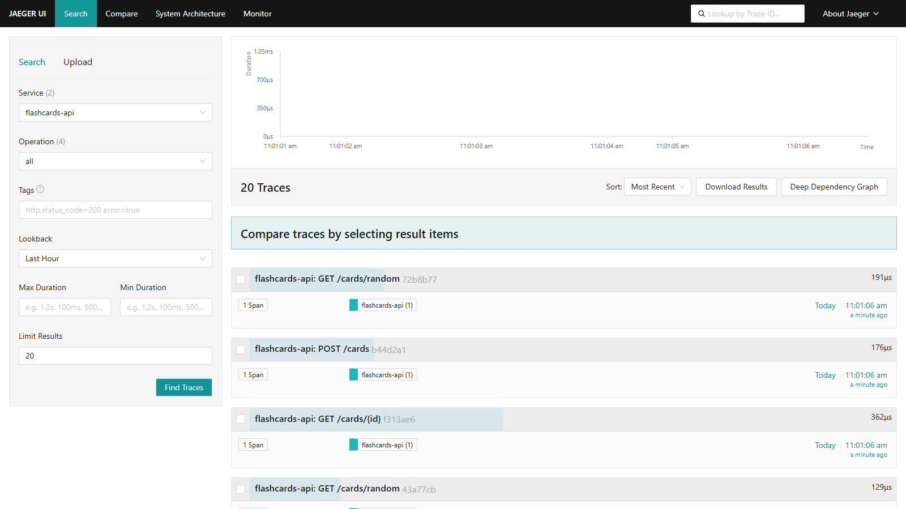

# DevOps Project — Flashcards API

[](https://github.com/mouhibfahem/devops/actions/workflows/ci.yml)

A small REST API to revise course topics with flashcards, used to practice DevOps
end to end: version control, CI/CD, containerization, Kubernetes, observability
and security.

The API starts with a few DevOps flashcards and has a **quiz mode**
(`GET /cards/random`) that returns a random question without its answer.

## Run locally

Requirements: [Go](https://go.dev/dl/) 1.24 or newer.

```bash
go run .                 # starts the API on http://localhost:8080
PORT=9000 go run .       # use another port
```

With `make` (Linux / macOS / Git Bash with make installed):

| Command         | What it does                         |
| --------------- | ------------------------------------ |
| `make run`      | Start the API                        |
| `make test`     | Run the unit tests                   |
| `make coverage` | Run the tests with a coverage report |
| `make lint`     | `go vet` + formatting check          |
| `make build`    | Build the binary into `bin/`         |

## API

| Method   | Path                    | Description                                   | Success |
| -------- | ----------------------- | --------------------------------------------- | ------- |
| `GET`    | `/health`               | Health check                                  | 200     |
| `GET`    | `/cards[?topic=docker]` | List cards, optionally filtered by topic      | 200     |
| `POST`   | `/cards`                | Create a card (`question` and `answer` required) | 201  |
| `GET`    | `/cards/{id}`           | Get one card                                  | 200     |
| `DELETE` | `/cards/{id}`           | Delete one card                               | 204     |
| `GET`    | `/cards/random[?topic=]`| Quiz: a random question, without the answer   | 200     |

Errors are returned as JSON, for example `{"error": "card not found"}`, with
status `400` (invalid input), `404` (not found) or `405` (method not allowed).

### Examples

```bash
curl http://localhost:8080/cards
curl "http://localhost:8080/cards?topic=docker"

curl -X POST http://localhost:8080/cards \
  -H "Content-Type: application/json" \
  -d '{"topic":"k8s","question":"What is a Pod?","answer":"The smallest deployable unit in Kubernetes"}'
# {"id":4,"topic":"k8s","question":"What is a Pod?","answer":"The smallest deployable unit in Kubernetes"}

curl http://localhost:8080/cards/random
# {"id":2,"question":"What is an SLO?","topic":"sre"}

curl -X DELETE http://localhost:8080/cards/4
```

> Cards are kept in memory: restarting the API resets them to the seeded cards.

## Docker

The image is built from a multi-stage [`Dockerfile`](Dockerfile): Go compiles a
static binary, then only that binary is copied into a minimal
[distroless](https://github.com/GoogleContainerTools/distroless) image
(about 16 MB, no shell, runs as a non-root user).

```bash
# Pull and run the published image from Docker Hub
docker run --rm -p 8080:8080 mouhibfahem/flashcards-api:latest

# Or build and run locally with Docker Compose
docker compose up -d --build
API_PORT=8085 docker compose up -d --build   # if port 8080 is already taken
docker compose logs -f api
docker compose down
```

Image on Docker Hub: [mouhibfahem/flashcards-api](https://hub.docker.com/r/mouhibfahem/flashcards-api)

## Observability

### Structured logs

Every request produces one JSON log line on stdout (Go `log/slog`), written by
the middleware in [`middleware.go`](middleware.go):

```json
{"time":"2026-10-11T10:42:04.07+01:00","level":"WARN","msg":"request","request_id":"a2ac2e44bc95dcde","trace_id":"72b8b7723092555e1df6374a7a4c204b","span_id":"3a5991220a14c2d0","method":"GET","path":"/cards/42","query":"","status":404,"duration_ms":0,"remote_addr":"[::1]:60504","user_agent":"curl/8.19.0"}
```

- **Level from the status code**: `INFO` (2xx/3xx), `WARN` (4xx), `ERROR` (5xx).
- **Request ID**: reused from the `X-Request-ID` header or generated, returned in
  the response header and present in every log line, to follow one request.
- **Panics** are recovered, logged at `ERROR` with the stack trace, and answered
  with a `500` instead of crashing the server.

Sample output: [`docs/evidence/sample-logs.jsonl`](docs/evidence/sample-logs.jsonl).
With Docker: `docker compose logs -f api`.

### Metrics and dashboard

The API exposes Prometheus metrics on **`GET /metrics`** ([`metrics.go`](metrics.go)):

| Metric | Type | Labels |
| --- | --- | --- |
| `http_requests_total` | counter | `method`, `route`, `status` |
| `http_request_duration_seconds` | histogram | `method`, `route` |
| `http_requests_in_flight` | gauge | — |

The `route` label is the matched pattern (`GET /cards/{id}`), not the raw path,
so the number of time series stays small. Go runtime metrics (`go_*`,
`process_*`) are exposed too.

Run the API with Prometheus and Grafana, then send some traffic:

```bash
docker compose up -d --build
./scripts/load.sh http://localhost:8080 200
```

| Service | URL |
| --- | --- |
| API | http://localhost:8080 |
| Prometheus | http://localhost:9090 |
| Grafana (dashboard **Flashcards API**, anonymous view, admin/admin) | http://localhost:3000 |
| Jaeger (traces) | http://localhost:16686 |

The Grafana data source and dashboard are provisioned from
[`observability/`](observability/), so they appear automatically. The dashboard
shows requests per second, error rates, p50/p95/p99 latency and traffic by route
and status:



### Tracing

Each request is traced with [OpenTelemetry](https://opentelemetry.io/)
([`tracing.go`](tracing.go)): the middleware starts one span per request, named
after its route (`GET /cards/{id}`), with the HTTP method, route and status code
as attributes. Spans are exported over OTLP/HTTP to **Jaeger** when
`OTEL_EXPORTER_OTLP_ENDPOINT` is set (Docker Compose does it).

- An incoming W3C `traceparent` header is continued, so the API can join a trace
  started by another service.
- Every log line carries `trace_id` and `span_id`: from a log line you can open
  the matching trace in Jaeger, and the other way round.

Jaeger UI: http://localhost:16686 (service **flashcards-api**).



## CI/CD

Every push to `main` and every pull request runs the
[CI workflow](.github/workflows/ci.yml) on GitHub Actions:

1. `gofmt` formatting check
2. `go vet` static checks
3. Unit tests with the race detector and a coverage report (shown in the run summary)
4. Build of the binary
5. Build of the Docker image — and, on `main` only, push to Docker Hub with the
   tags `latest` and `sha-<commit>`

Docker Hub credentials are stored as GitHub secrets (`DOCKERHUB_USERNAME`,
`DOCKERHUB_TOKEN`), never in the code. The coverage report is kept as a downloadable artifact of each run.

## Roadmap

Progress is tracked in [GitHub Issues](https://github.com/mouhibfahem/devops/issues):
CI/CD, Docker, structured logs, metrics, tracing, security scans and Kubernetes
deployment.
